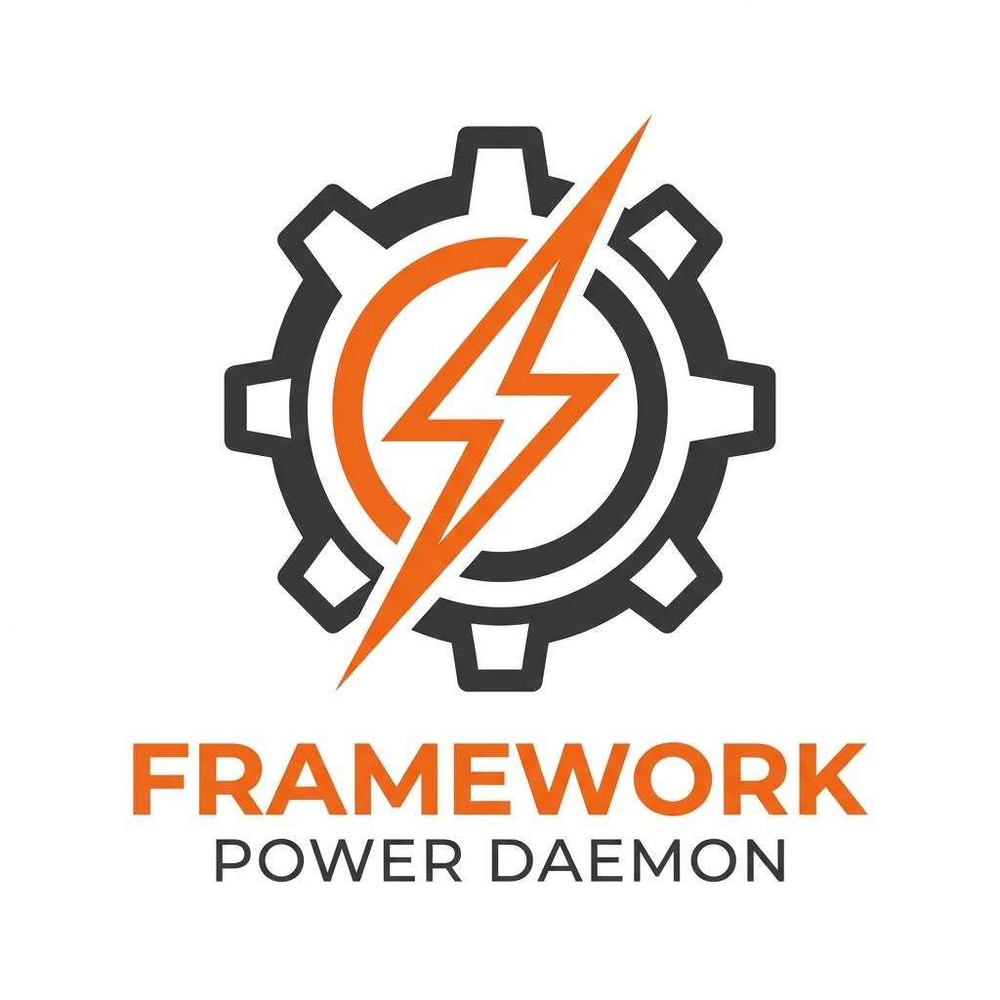
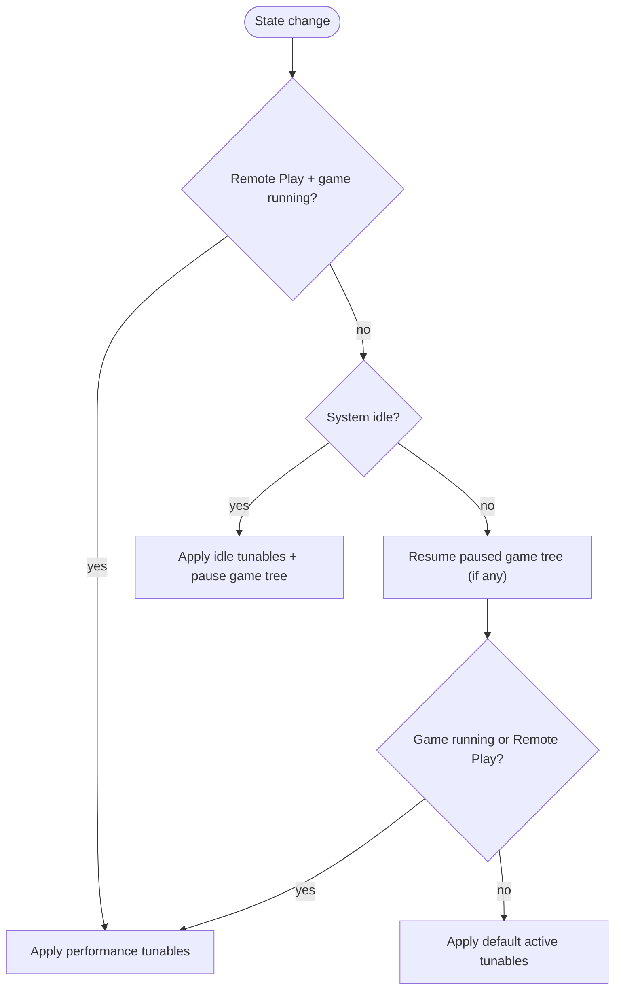

<p align="center">
  
</p>

A Go daemon to automatically manage power profiles on the **Framework Desktop**, specifically tailored for hybrid setups acting as both a **Steam Gaming Console** and an **AI Server**.

> [!IMPORTANT]
> This daemon is designed for [**Framework Desktop**](https://frame.work/desktop) usage and has been explicitly tested on [**CachyOS**](https://cachyos.org). It keeps the APU in a **balanced** profile with low wake-up latency for the 24/7 AI server, applies performance tunables when gaming (Active or Remote Play), and drastically reduces power consumption during idle operation.

## Features

- **Automated Power Management**: Switches to "Performance" during active usage (Gaming/Input) and "Powersave" during inactivity.
- **Idle Detection**: Monitors raw input activity (default 5-minute timeout). Support for **Joystick Deadzones** and **Event Deduplication** to prevent drift.
- **Game Pausing**: Recursively pauses the entire process tree of a Steam game (including Proton/Wine wrappers) when idle. **Syncs state** on startup to prevent conflicts.
- **Steam Remote Play Detection**: Detects virtual input devices from Remote Play (specifically `js` interfaces) to keep the system active.
- **GPU and CPU Monitoring**: Tracks AMD GPU metrics via sysfs (VRAM, GTT, temperature, power), CPU usage via `/proc/stat` and the CPU die temperature from `k10temp`.
- **NPU Monitoring**: Reads AMD XDNA telemetry through the accel DRM interface: NPU power, per-column AIE utilization, clocks, TOPs, hardware contexts with owning PIDs, firmware, and a switchable power mode.
- **EC Fan Control**: Drives the Framework EC fan with a temperature curve: a steady 50 % baseline, a ramp from 75 to 90 °C, hysteresis and a systemd fallback that hands the fan back to the EC when the daemon stops.
- **SMART Health Monitoring**: Monitors smartd journald logs, keeps sticky persisted alerts, and classifies health, wear and sector failures.
- **NVMe Health Polling**: Directly polls `nvme smart-log`/`smartctl` for wear, available spare, media errors, error-log growth and temperature, with configurable warning/critical thresholds.
- **Storage Notifications**: Home Assistant persistent notifications and optional `notify_service` calls for new SMART/NVMe warnings.
- **LLM Request Accounting**: Attributes LLM API requests to client IPs and IP groups by reading a Caddy access log in front of `llama-server`, with per-day request shares, energy and cost estimates.
- **HA Controls**: Selects for performance/powersave, NPU power mode and fan mode, a button to reset the idle timer, and `framework_powerd.*` services for automations.
- **Daemon Health**: `/status.health` and a diagnostic HA sensor expose turbostat, NVMe, metrics persistence and overall daemon status.
- **Persistent Energy Metrics**: 24h, 7d and lifetime energy aggregates survive daemon restarts (atomic JSON state file).
- **Health Endpoint**: Unauthenticated `/healthz` with monitor and persistence status for systemd/monitoring probes.
- **REST API**: Allows manual mode overriding, idle resetting, and usage statistics.
- **JWT Authentication**: Secure API access with JSON Web Tokens.
- **Configuration File**: JSON-based daemon configuration.
- **Systemd Integration**: Runs effectively as a background service.

## Documentation

- [Configuration](docs/configuration.md) — every key, defaults and precedence
- [REST API](docs/api.md) — endpoints, response schemas and examples
- [Home Assistant entities](docs/home_assistant.md) — setup, entity table, dashboard example
- [Architecture](docs/architecture.md) — components, state machine, persistence
- [Troubleshooting](docs/troubleshooting.md) — tools, permissions, watchdog, HA
- [Security](docs/security.md) — JWT, network exposure, systemd hardening
- [LLM request accounting](docs/llm.md) — Caddy setup, IP groups, per-day shares
- [AMD XDNA NPU monitoring](docs/npu.md) — accel telemetry, contexts, power mode
- [EC fan control](docs/fan.md) — curve, safety, calibration
- [Migration to 1.3](docs/migration-1.3.md) — historical: Ollama removal and entity changes
- [Idle detection](docs/idle_logic.md) — detailed idle-state logic
- [Changelog](CHANGELOG.md)

## Architecture & Flow

The daemon combines input, Steam and Remote Play detection with power, GPU,
SMART, NVMe, NPU, LLM and fan telemetry. Only input, Steam, Remote Play and the
API drive the power state machine; the rest feeds `/status`, `/healthz` and
Home Assistant.

The component diagram, monitor lifecycle and persistence internals are in
[Architecture](docs/architecture.md); the idle detection deep dive is in
[Idle Detection Logic](docs/idle_logic.md).

## Power monitoring and persistence

- CPU and package power come from `turbostat`. Energy is integrated over the
  real elapsed time between samples, capped at 60 seconds, so a suspend/resume
  gap cannot inject an implausible jump. The estimated total is `PkgWatt` plus
  the peripheral estimate, corrected for VRM loss; `CorWatt` is a subset of
  `PkgWatt` and is not added again.
- The daemon keeps a 24 hour and 7 day ring plus a lifetime counter in
  `/var/lib/framework-powerd/metrics.json`, written atomically every
  `metrics.save_interval`, on the hour and on shutdown.
- The ring is rotated forward on startup and the missed slots are zeroed, so
  downtime is never charged to an hour. A state file older than seven days is
  discarded.
- Wi-Fi and Ethernet devices are excluded from runtime power management.
  Chipsets such as the MediaTek MT7925 drop the link under aggressive ASPM or
  `powertop --auto-tune`.

## Power State Flow

The daemon pins the APU profile trio — `powerprofilesctl` **balanced**, CPU EPP **balance_performance**, scaling governor **powersave** — once at startup and re-asserts it on every transition. It never flips these per mode: the balanced profile keeps inference wake-up latency low while the 24/7 llama server is running, and the hardware scales dynamically. The scx scheduler (`scx_lavd`) is likewise pinned to **gaming** mode.

What *does* switch with idle detection is the secondary tuning layer:

| Tunable | Active Usage | Idle |
|---|---|---|
| PCIe ASPM | `performance` | `powersupersave` |
| powertop auto-tune | off | on |
| USB autosuspend / audio power-save | disabled | may re-enable* |
| Game processes | running | recursively paused |

\* USB/audio latency is disabled (reverted) on active transitions; during idle, `powertop --auto-tune` may re-enable autosuspend/power-save. Network devices are always excluded for stability.

**Remote Play + a running game** takes priority over idle. Otherwise idle wins; when active, a running game or Remote Play selects performance tunables, and an active desktop uses the default-active tunables.



## Prerequisites

The daemon relies on the following tools:

- `powerprofilesctl`: For pinning the balanced system power profile.
- `turbostat`: For accurate power monitoring (usually part of `linux-tools` or `linux-cpupower`).
- `libsystemd-dev`: Required for building (SMART journald integration uses cgo).
- `smartmontools` (`smartd`, `smartctl`): SMART journal monitoring and NVMe fallback polling.
- `nvme-cli` (`nvme`): Preferred direct NVMe health polling (optional but recommended).
- `framework_tool`: EC fan control and fan telemetry (optional; control requires root).
- `powertop` (Optional): For auto-tuning power parameters.
- `scxctl` (Optional): For sched-ext scheduler management (pinned to gaming mode).

### GPU Monitoring

For AMD GPU metrics, ensure your GPU is accessible via sysfs:
- `/sys/class/drm/card*/device/` must contain `mem_info_vram_*`, `mem_info_gtt_*`
- For temperature/power: `hwmon` interface must be present

### SMART Health Monitoring

Configure smartd to log to journald. Add to `/etc/smartd.conf`:
```
/dev/sda -a -H -l error -l selftest -m root
```
Or for NVMe:
```
/dev/nvme0 -a -W 5,60,70 -m root
```

The daemon also polls NVMe health directly every 15 minutes, so wear and
spare-capacity warnings do not depend on a journal event. Thresholds and
persistence are configured in the `nvme` and `smartd` sections; see
[Configuration](docs/configuration.md). Alerts survive daemon restarts and are
exposed through `/smartd/stats`, `/nvme/stats` and the Storage Health sensor.

## Installation

### Makefile (recommended)

```bash
git clone https://github.com/zaolin/framework-powerd.git
cd framework-powerd
make install    # build, binary, config, JWT secret and systemd unit
make enable     # systemctl enable --now framework-powerd
make token      # print a JWT token for Home Assistant
```

`make install`:

- builds with the version injected from `git describe`,
- installs the binary to `/usr/local/bin/framework-powerd`,
- installs `configs/config.example.json` to `/etc/framework-powerd/config.json` **only if no config exists**,
- creates `/etc/framework-powerd/env` with a random `JWT_SECRET` (mode `600`) when neither that file nor `server.jwt_secret` exists,
- installs the unit to `/etc/systemd/system/framework-powerd.service` and runs `systemctl daemon-reload`.

Additional targets:

| Target | Action |
|---|---|
| `make enable` | Enable and start the service, then show its status. |
| `make disable` | Stop and disable the service. |
| `make uninstall` | Remove unit and binary; keep config and JWT secret. |
| `make token` | Print a token signed with the installed JWT secret. |

The targets use `sudo` internally. Run `make install SUDO=` as root, or override
paths with `PREFIX`, `BINDIR`, `CONFIG_DIR` and `SYSTEMD_DIR`. If you change
`CONFIG_DIR`, update `EnvironmentFile` in the unit accordingly.

### Manual installation

1.  **Clone the repository**:
    ```bash
    git clone https://github.com/zaolin/framework-powerd.git
    cd framework-powerd
    ```

2.  **Build**:
    ```bash
    go build ./cmd/framework-powerd
    ```

3.  **Install Binary**:
    ```bash
    sudo cp framework-powerd /usr/local/bin/
    ```

4.  **Install Service**:
    ```bash
    sudo cp configs/systemd/framework-powerd.service /etc/systemd/system/
    sudo systemctl daemon-reload
    sudo systemctl enable --now framework-powerd
    ```

The unit uses `Type=notify` with a 30-second watchdog: the daemon sends `READY=1`
after binding the API and pings the watchdog while running. `StateDirectory`
creates `/var/lib/framework-powerd` for the persisted metrics. The optional
`EnvironmentFile=-/etc/framework-powerd/env` supplies `JWT_SECRET` on systems
installed via `make install`.

## Usage

### CLI Flags

You can customize the daemon's behavior with flags:

```bash
# Debug mode (verbose logs)
framework-powerd serve --debug

# Custom Idle Timeout (overrides server.idle_timeout; default 5m)
framework-powerd serve --idle-timeout 30s

# Print the build version
framework-powerd --version
```

### Home Assistant Integration

This project is compatible with [HACS](https://hacs.xyz/) (Home Assistant Community Store).

**Installation via HACS**:
1.  Open **HACS** in Home Assistant.
2.  Click the menu (three dots) in the top right corner and select **Custom repositories**.
3.  Add the repository URL: `https://github.com/zaolin/framework-powerd`.
4.  Select **Integration** as the Category and click **Add**.
5.  Find **Framework Power Daemon** in the list and click **Download**.
6.  Restart Home Assistant.
7.  Go to **Settings > Devices & Services > Add Integration**.
8.  Search for **Framework Power Daemon** and configure it.
    *   **Host**: IP address of the daemon (e.g. `192.168.1.x` or `localhost` if on same machine).
    *   **Port**: `8080` (default).
    *   **JWT Secret**: If you started the daemon with a secret.

**Entities** are grouped into sub-devices under the daemon device: GPU, NPU,
Fan, LLM, one device per NVMe drive, Storage and SMART. Every temperature is a
normal sensor; capacities, wear counters and system information are diagnostic.
The full table, the device layout and a dashboard example are in
[Home Assistant entities](docs/home_assistant.md).

### API Control

The REST API defaults to port 8080. Every endpoint except `/healthz` requires
the JWT token when authentication is enabled.

```bash
export TOKEN=$(/usr/local/bin/framework-powerd token --secret="mysecret")
curl -H "Authorization: Bearer $TOKEN" http://localhost:8080/status
curl -X POST -H "Authorization: Bearer $TOKEN" -d '{"mode":"powersave"}' http://localhost:8080/mode
```

Endpoints, payloads and error codes are in [REST API](docs/api.md). Token
handling, network exposure and rate limits are in [Security](docs/security.md).

## Configuration

The daemon reads `/etc/framework-powerd/config.json`. `make install` creates it
from [`configs/config.example.json`](configs/config.example.json). Every key,
default and validation rule is documented in
[Configuration](docs/configuration.md).

```bash
/usr/local/bin/framework-powerd serve --config=/etc/framework-powerd/config.json
```

CLI flags override the file. See [CLI Flags](#cli-flags) for the common ones and
[Configuration](docs/configuration.md) for the precedence rules.
