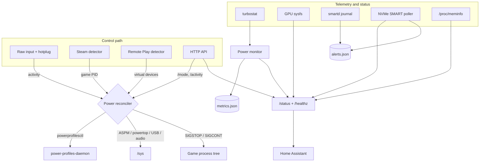
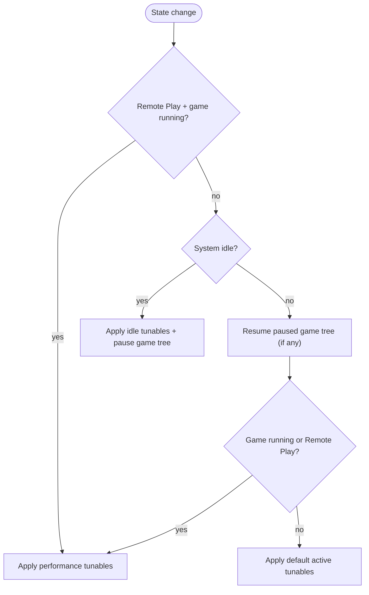

<p align="center">
  
</p>

A Go daemon to automatically manage power profiles on the **Framework Desktop**, specifically tailored for hybrid setups acting as both a **Steam Gaming Console** and an **AI Server**.

> [!IMPORTANT]
> This daemon is designed for [**Framework Desktop**](https://frame.work/desktop) usage and has been explicitly tested on [**CachyOS**](https://cachyos.org). It keeps the APU in a **balanced** profile with low wake-up latency for the 24/7 AI server, applies performance tunables when gaming (Active or Remote Play), and drastically reduces power consumption during idle operation.

## Features

- **Automated Power Management**: Switches to "Performance" during active usage (Gaming/Input) and "Powersave" during inactivity.
- **Idle Detection**: Monitors raw input activity (default 5-minute timeout). Support for **Joystick Deadzones** and **Event Deduplication** to prevent drift.
- **Game Pausing**: Recursively pauses the entire process tree of a Steam game (including Proton/Wine wrappers) when idle. **Syncs state** on startup to prevent conflicts.
- **Steam Remote Play Detection**: Detects virtual input devices from Remote Play (specifically `js` interfaces) to keep the system active.
- **GPU Monitoring**: Tracks AMD GPU metrics via sysfs (VRAM, GTT, temperature, power) and system CPU usage via `/proc/stat`.
- **SMART Health Monitoring**: Monitors smartd journald logs, keeps sticky persisted alerts, and classifies health, wear and sector failures.
- **NVMe Health Polling**: Directly polls `nvme smart-log`/`smartctl` for wear, available spare, media errors, error-log growth and temperature, with configurable warning/critical thresholds.
- **Storage Notifications**: Home Assistant persistent notifications and optional `notify_service` calls for new SMART/NVMe warnings.
- **LLM Request Accounting**: Attributes LLM API requests to client IPs and IP groups by reading a Caddy access log in front of `llama-server`, with per-day request shares, energy and cost estimates.
- **HA Controls**: Select entity for performance/powersave, button to reset the idle timer, and `framework_powerd.*` services for automations.
- **Daemon Health**: `/status.health` and a diagnostic HA sensor expose turbostat, NVMe, metrics persistence and overall daemon status.
- **Persistent Energy Metrics**: 24h, 7d and lifetime energy aggregates survive daemon restarts (atomic JSON state file).
- **Health Endpoint**: Unauthenticated `/healthz` with monitor and persistence status for systemd/monitoring probes.
- **REST API**: Allows manual mode overriding, idle resetting, and usage statistics.
- **JWT Authentication**: Secure API access with JSON Web Tokens.
- **Configuration File**: JSON-based daemon configuration.
- **Systemd Integration**: Runs effectively as a background service.

## Documentation

- [Configuration](docs/configuration.md) — every key, defaults and precedence
- [REST API](docs/api.md) — endpoints, response schemas and examples
- [Home Assistant entities](docs/home_assistant.md) — setup, entity table, dashboard example
- [Architecture](docs/architecture.md) — components, state machine, persistence
- [Troubleshooting](docs/troubleshooting.md) — tools, permissions, watchdog, HA
- [Security](docs/security.md) — JWT, network exposure, systemd hardening
- [LLM request accounting](docs/llm.md) — Caddy setup, IP groups, per-day shares
- [Migration to 1.3](docs/migration-1.3.md) — Ollama removal and entity changes
- [Idle detection](docs/idle_logic.md) — detailed idle-state logic
- [Changelog](CHANGELOG.md)

## Architecture & Flow

The daemon combines raw input, Steam and Remote Play detection with power, GPU, SMART and NVMe telemetry. Only input, Steam, Remote Play and the API drive the power state machine; telemetry feeds `/status`, `/healthz` and Home Assistant.



## Power Monitoring

The daemon uses `turbostat` to provide accurate, real-time power consumption metrics.

*   **Source**: `turbostat` (running via `sudo`, reading MSRs).
*   **Metrics**:
    *   **Package**: Total package power.
    *   **Core**: CPU Core power.
    *   **RAM**: Memory power.
*   **Total Energy**: Calculated as `PkgWatt` + `RAMWatt`. `CorWatt` is a subset of `PkgWatt` (cores only) and is deliberately not added, to avoid double-counting.
*   **History**: Tracks 24-hour and 7-day rolling energy consumption in **kWh**, plus a monotonic **lifetime** counter. The aggregates are persisted to `/var/lib/framework-powerd/metrics.json` (atomic writes) and survive daemon restarts; a gap during downtime is not attributed to any hour.
*   **Integration**: Energy is integrated over the real elapsed time between turbostat samples, capped at 60 seconds so a suspend/resume gap cannot inject an implausible jump. If turbostat exits, it is restarted with exponential backoff.

## Metrics Persistence

The 24h/7d ring buffer and the lifetime energy counter are written atomically to
`/var/lib/framework-powerd/metrics.json` every `metrics.save_interval`, on every
hour boundary, and on graceful shutdown. On startup the daemon rotates the ring
forward by the hours it was down and zeroes the missed slots, so downtime is
never charged to a request. A state file older than seven days is discarded.

Writes use a temp file, `fsync`, `rename` and a directory `fsync`; a crash or
power loss cannot leave a truncated JSON file behind. Corrupt or incompatible
state files are logged and ignored, and the daemon starts with a fresh buffer.
The systemd unit sets `StateDirectory=framework-powerd` to create the directory.

## Network Device Stability

Network devices (Wi-Fi and Ethernet) are explicitly excluded from Runtime Power Management (forced to `on`) to prevent connection drops and instability. This is particularly important for chipsets like the **MediaTek MT7925 (Wi-Fi 7)** which are known to be unstable with `powertop --auto-tune` or aggressive ASPM. The status of these devices can be verified via the `/status` API endpoint.

## Power State Flow

The daemon pins the APU profile trio — `powerprofilesctl` **balanced**, CPU EPP **balance_performance**, scaling governor **powersave** — once at startup and re-asserts it on every transition. It never flips these per mode: the balanced profile keeps inference wake-up latency low while the 24/7 llama server is running, and the hardware scales dynamically. The scx scheduler (`scx_lavd`) is likewise pinned to **gaming** mode.

What *does* switch with idle detection is the secondary tuning layer:

| Tunable | Active Usage | Idle |
|---|---|---|
| PCIe ASPM | `performance` | `powersupersave` |
| powertop auto-tune | off | on |
| USB autosuspend / audio power-save | disabled | may re-enable* |
| Game processes | running | recursively paused |

\* USB/audio latency is disabled (reverted) on active transitions; during idle, `powertop --auto-tune` may re-enable autosuspend/power-save. Network devices are always excluded for stability.

**Remote Play + a running game** takes priority over idle. Otherwise idle wins; when active, a running game or Remote Play selects performance tunables, and an active desktop uses the default-active tunables.



## How it works

1.  **Monitoring**:
    *   **Remote Play**: Polls `/proc/bus/input/devices` to detect virtual joysticks.
    *   **Input**: Monitors `/dev/input/js*` (with deadzone) and valid `/dev/input/event*` devices. Ignores noise and init bursts.
    *   **Steam**: Periodically checks for running Steam games and identifies the "Reaper" root process.
    *   **Power**: Reads `turbostat` samples and aggregates 24h/7d/lifetime energy.
    *   **GPU**: Reads VRAM, GTT, temperature, power and CPU usage from sysfs.
    *   **SMART/NVMe**: Follows smartd journal alerts and polls NVMe health directly.
    *   **Memory**: Reads `/proc/meminfo` for used/free/available RAM.

> [!NOTE]
> For the detailed component and data flow, see [Architecture](docs/architecture.md). For the idle detection mechanism, see [Idle Detection Logic](docs/idle_logic.md).


2.  **Decision Making**:
    *   **Priority 1: Remote Play + Game** -> **Performance Tunables**, idle is ignored.
    *   **Priority 2: Idle (No Active Usage)** -> **Idle Tunables** (ASPM powersupersave, powertop auto-tune); pause the game tree.
    *   **Priority 3: Active Game/Remote Play** -> **Performance Tunables**; resume a paused game.
    *   **Priority 4: Active Desktop** -> **Default Active Tunables**; resume a paused game.
3.  **Action**:
    *   Pins the APU profile trio to balanced, applies per-state tunables, and manages Process States (Running/Stopped).

## Prerequisites

The daemon relies on the following tools:

- `powerprofilesctl`: For pinning the balanced system power profile.
- `turbostat`: For accurate power monitoring (usually part of `linux-tools` or `linux-cpupower`).
- `libsystemd-dev`: Required for building (SMART journald integration uses cgo).
- `smartmontools` (`smartd`, `smartctl`): SMART journal monitoring and NVMe fallback polling.
- `nvme-cli` (`nvme`): Preferred direct NVMe health polling (optional but recommended).
- `powertop` (Optional): For auto-tuning power parameters.
- `scxctl` (Optional): For sched-ext scheduler management (pinned to gaming mode).

### GPU Monitoring

For AMD GPU metrics, ensure your GPU is accessible via sysfs:
- `/sys/class/drm/card*/device/` must contain `mem_info_vram_*`, `mem_info_gtt_*`
- For temperature/power: `hwmon` interface must be present

### SMART Health Monitoring

Configure smartd to log to journald. Add to `/etc/smartd.conf`:
```
/dev/sda -a -H -l error -l selftest -m root
```
Or for NVMe:
```
/dev/nvme0 -a -W 5,60,70 -m root
```

The daemon also polls NVMe health directly every 15 minutes, so wear and
spare-capacity warnings do not depend on a journal event. Thresholds and
persistence are configured in the `nvme` and `smartd` sections; see
[Configuration](docs/configuration.md). Alerts survive daemon restarts and are
exposed through `/smartd/stats`, `/nvme/stats` and the Storage Health sensor.

## Installation

### Makefile (recommended)

```bash
git clone https://github.com/zaolin/framework-powerd.git
cd framework-powerd
make install    # build, binary, config, JWT secret and systemd unit
make enable     # systemctl enable --now framework-powerd
make token      # print a JWT token for Home Assistant
```

`make install`:

- builds with the version injected from `git describe`,
- installs the binary to `/usr/local/bin/framework-powerd`,
- installs `configs/config.example.json` to `/etc/framework-powerd/config.json` **only if no config exists**,
- creates `/etc/framework-powerd/env` with a random `JWT_SECRET` (mode `600`) when neither that file nor `server.jwt_secret` exists,
- installs the unit to `/etc/systemd/system/framework-powerd.service` and runs `systemctl daemon-reload`.

Additional targets:

| Target | Action |
|---|---|
| `make enable` | Enable and start the service, then show its status. |
| `make disable` | Stop and disable the service. |
| `make uninstall` | Remove unit and binary; keep config and JWT secret. |
| `make token` | Print a token signed with the installed JWT secret. |

The targets use `sudo` internally. Run `make install SUDO=` as root, or override
paths with `PREFIX`, `BINDIR`, `CONFIG_DIR` and `SYSTEMD_DIR`. If you change
`CONFIG_DIR`, update `EnvironmentFile` in the unit accordingly.

### Manual installation

1.  **Clone the repository**:
    ```bash
    git clone https://github.com/zaolin/framework-powerd.git
    cd framework-powerd
    ```

2.  **Build**:
    ```bash
    go build ./cmd/framework-powerd
    ```

3.  **Install Binary**:
    ```bash
    sudo cp framework-powerd /usr/local/bin/
    ```

4.  **Install Service**:
    ```bash
    sudo cp configs/systemd/framework-powerd.service /etc/systemd/system/
    sudo systemctl daemon-reload
    sudo systemctl enable --now framework-powerd
    ```

The unit uses `Type=notify` with a 30-second watchdog: the daemon sends `READY=1`
after binding the API and pings the watchdog while running. `StateDirectory`
creates `/var/lib/framework-powerd` for the persisted metrics. The optional
`EnvironmentFile=-/etc/framework-powerd/env` supplies `JWT_SECRET` on systems
installed via `make install`.

## Usage

### CLI Flags

You can customize the daemon's behavior with flags:

```bash
# Debug mode (verbose logs)
framework-powerd serve --debug

# Custom Idle Timeout (overrides server.idle_timeout; default 5m)
framework-powerd serve --idle-timeout 30s

# Print the build version
framework-powerd --version
```

### Home Assistant Integration

This project is compatible with [HACS](https://hacs.xyz/) (Home Assistant Community Store).

**Installation via HACS**:
1.  Open **HACS** in Home Assistant.
2.  Click the menu (three dots) in the top right corner and select **Custom repositories**.
3.  Add the repository URL: `https://github.com/zaolin/framework-powerd`.
4.  Select **Integration** as the Category and click **Add**.
5.  Find **Framework Power Daemon** in the list and click **Download**.
6.  Restart Home Assistant.
7.  Go to **Settings > Devices & Services > Add Integration**.
8.  Search for **Framework Power Daemon** and configure it.
    *   **Host**: IP address of the daemon (e.g. `192.168.1.x` or `localhost` if on same machine).
    *   **Port**: `8080` (default).
    *   **JWT Secret**: If you started the daemon with a secret.

**Sensors Provided** (full table in [Home Assistant entities](docs/home_assistant.md)):
*   **Power Mode**: `balanced` (the APU profile trio is pinned)
*   **Tunable Mode**: `performance` / `powersave` (diagnostic; selectable via the `Power Tunable Mode` select entity)
*   **Reset Idle Timer**: button
*   **Daemon Health**: `ok` / `degraded` with turbostat, NVMe and persistence details (diagnostic)
*   **System Idle**: `True` / `False`
*   **Game Status**: PID and Running/Paused state
*   **Power Usage**: Estimated total and peripheral power (Watts)
*   **Energy Consumption**: Last 24h, 7 Days and lifetime total (kWh; persisted across daemon restarts)
*   **RAM**: Used, Free, Available (GiB) and Usage (%)
*   **Uptime**: System uptime (duration)
*   **Polling Interval**: Configurable number entity (seconds)
*   **GPU Metrics** (if enabled):
    *   GPU Temperature (°C)
    *   GPU Power (Watts)
    *   GPU VRAM Used/Total/Free (GiB) and Usage (%)
    *   GPU GTT Used/Total/Free (GiB) and Usage (%)
    *   CPU Usage (%)
*   **SMART Health** (if enabled):
    *   SMART Alert (Binary Sensor)
    *   SMART Alerts Count
*   **NVMe Health** (if enabled):
    *   Per-device Health, Percentage Used, Available Spare, Media Errors, Error Log Entries, Temperature, Data Written, Power-On Hours, Unsafe Shutdowns
    *   Storage Health (aggregated problem binary sensor)
*   **LLM Requests** (if enabled):
    *   Total and today request counts, today's energy and cost
    *   Per-group counts and shares, per-IP counts with the share as an attribute
*   **System Information** (diagnostic): Kernel, OS, CPU model, total RAM, daemon version

### API Control

Trigger modes manually using the REST API (default port 8080). Both `performance` and `powersave` re-assert the balanced APU profile; they switch only the secondary tunables (ASPM, powertop, USB/audio latency). The full reference is in [REST API](docs/api.md).

The Home Assistant integration exposes the same actions as `framework_powerd.set_mode`, `framework_powerd.reset_idle` and `framework_powerd.refresh` services, plus a select entity and reset button.

If JWT authentication is enabled, you must export your token first:
```bash
export TOKEN="your_jwt_token_here"
```

- **Apply Active Tunables** (performance):
  ```bash
  curl -H "Authorization: Bearer $TOKEN" -X POST -d '{"mode":"performance"}' http://localhost:8080/mode
  ```

- **Apply Idle Tunables** (powersave):
  ```bash
  curl -H "Authorization: Bearer $TOKEN" -X POST -d '{"mode":"powersave"}' http://localhost:8080/mode
  ```

- **Trigger Activity (Reset Idle Timer)**:
  ```bash
  curl -H "Authorization: Bearer $TOKEN" -X POST http://localhost:8080/activity
  ```

- **Get Status**:
  ```bash
  curl -H "Authorization: Bearer $TOKEN" http://localhost:8080/status
  ```

- **Get SMART Stats** (if enabled):
  ```bash
  curl -H "Authorization: Bearer $TOKEN" http://localhost:8080/smartd/stats
  # Output: {"alerts":[{"device":"/dev/sda","fail_type":"SelfTest",...}]}
  ```

- **Health Check** (no authentication required):
  ```bash
  curl http://localhost:8080/healthz
  # Output includes status, version, uptime, power sample age, monitor
  # booleans and the metrics persistence state.
  ```

### Authentication

To enable JWT authentication, start the daemon with the `--jwt-secret` flag:

```bash
/usr/local/bin/framework-powerd serve --jwt-secret="mysecret"
```

To generate a token:

```bash
/usr/local/bin/framework-powerd token --secret="mysecret"
```

Use the token in your requests:

```bash
export TOKEN=$(/usr/local/bin/framework-powerd token --secret="mysecret")
curl -H "Authorization: Bearer $TOKEN" http://localhost:8080/status
```

## Configuration

The daemon supports a JSON configuration file. The full reference is in [Configuration](docs/configuration.md). Create `/etc/framework-powerd/config.json`:

```json
{
  "server": {
    "address": "0.0.0.0",
    "port": 8080,
    "jwt_secret": "",
    "idle_timeout": "5m"
  },
  "smartd": {
    "enabled": true,
    "service_unit": "smartd.service",
    "notify_service": "notify.mobile_phone",
    "alert_retention": "168h",
    "state_file": "/var/lib/framework-powerd/alerts.json"
  },
  "nvme": {
    "enabled": true,
    "poll_interval": "15m",
    "warn_percentage_used": 80,
    "crit_percentage_used": 90,
    "warn_available_spare": 10,
    "warn_temperature_c": 70,
    "crit_temperature_c": 80,
    "warn_err_log_entries": 1,
    "crit_err_log_entries": 10,
    "max_media_errors": 0
  },
  "gpu": {
    "enabled": true,
    "poll_interval": "5s"
  },
  "metrics": {
    "persist": true,
    "state_file": "/var/lib/framework-powerd/metrics.json",
    "save_interval": "5m"
  },
  "llm": {
    "enabled": false,
    "access_log": "/var/log/caddy/llm-access.log",
    "ignore_local_ip": true,
    "groups": [
      {"name": "home", "cidrs": ["192.168.0.0/16"]},
      {"name": "vpn", "cidrs": ["10.8.0.0/24"]}
    ],
    "history_days": 30,
    "state_file": "/var/lib/framework-powerd/llm.json",
    "save_interval": "1m"
  },
  "pricing": {
    "energy_price_per_kwh": 0.30,
    "currency": "EUR"
  }
}
```

### Configuration Options

| Section | Option | Type | Default | Description |
|---------|--------|------|---------|-------------|
| `server.address` | Address | string | `localhost` | IP to bind to |
| `server.port` | Port | int | `8080` | HTTP port |
| `server.idle_timeout` | Idle Timeout | duration | `5m` | Time before idle |
| `smartd.enabled` | Enabled | bool | `false` | Enable SMART monitoring |
| `smartd.notify_service` | Notify Service | string | `""` | HA notify service for new warnings |
| `smartd.alert_retention` | Alert Retention | duration | `168h` | How long a sticky alert stays visible |
| `smartd.state_file` | State File | string | `/var/lib/framework-powerd/alerts.json` | Persisted alert state |
| `nvme.enabled` | Enabled | bool | `true` | Direct NVMe health polling |
| `nvme.poll_interval` | Poll Interval | duration | `15m` | NVMe polling frequency |
| `nvme.warn_percentage_used` | Wear Warning | int | `80` | Wear warning threshold (%) |
| `nvme.crit_percentage_used` | Wear Critical | int | `90` | Wear critical threshold (%) |
| `nvme.warn_available_spare` | Spare Warning | int | `10` | Spare warning threshold (%) |
| `nvme.warn_temperature_c` | Temp Warning | int | `70` | Temperature warning (°C) |
| `nvme.crit_temperature_c` | Temp Critical | int | `80` | Temperature critical (°C) |
| `gpu.enabled` | Enabled | bool | `false` | Enable GPU monitoring |
| `gpu.poll_interval` | Poll Interval | duration | `5s` | GPU polling frequency |
| `metrics.persist` | Persist | bool | `true` | Persist energy aggregates across restarts |
| `metrics.state_file` | State File | string | `/var/lib/framework-powerd/metrics.json` | Atomic JSON state path |
| `metrics.save_interval` | Save Interval | duration | `5m` | Periodic flush interval |
| `llm.enabled` | Enabled | bool | `false` | Enable LLM request accounting |
| `llm.access_log` | Access Log | string | `/var/log/caddy/llm-access.log` | Proxy access log to read |
| `llm.groups` | Groups | list | `[]` | Named IP groups (`name` + `cidrs`) |
| `llm.exclude_ips` | Excluded IPs | list | `[]` | IPs that are never counted |
| `llm.counted_paths` | Counted Paths | list | inference paths | Only these request paths are counted |
| `llm.history_days` | History Days | int | `30` | Days of history to keep, including today |
| `llm.state_file` | State File | string | `/var/lib/framework-powerd/llm.json` | Persisted accounting state |
| `llm.save_interval` | Save Interval | duration | `1m` | Periodic flush interval |
| `llm.ignore_local_ip` | Ignore Local IP | bool | `true` | Skip loopback traffic |
| `pricing.energy_price_per_kwh` | Price per kWh | float | `0.30` | Energy price for cost estimates |
| `pricing.currency` | Currency | string | `EUR` | ISO 4217 code used as the cost sensor unit |

Run with config:
```bash
/usr/local/bin/framework-powerd serve --config=/etc/framework-powerd/config.json
```

CLI flags override config file values:
- `--address`: The IP address to listen on (default: `localhost`). Use `0.0.0.0` to listen on all interfaces.
- `--port`: The port to listen on (default: `8080`).
- `--idle-timeout`: Overrides `server.idle_timeout`.

> **Note**: If you change the port or address, remember to update your API calls accordingly.

