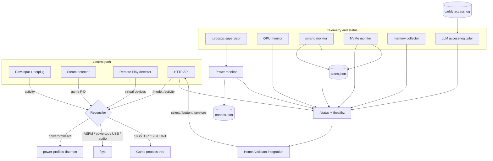

# Architecture

`framework-powerd` is a single Go binary with a small Home Assistant companion
integration. The daemon owns the power state machine; the integration is a
read-mostly API client with a small control surface (mode select, idle reset,
services).

## Components

| Package | Responsibility |
|---|---|
| `internal/monitor` | Raw input watching, joystick deadzones, hotplug via fsnotify, idle timer. |
| `internal/detector` | Steam game detection and Steam Remote Play virtual devices. |
| `internal/power` | Power profile pinning, tunables, process pauser, turbostat, energy aggregation, metrics persistence. |
| `internal/gpu` | AMD GPU sysfs metrics (VRAM/GTT/temperature/power) and CPU usage. |
| `internal/nvme` | Direct NVMe SMART polling (`nvme smart-log` / `smartctl`) and threshold evaluation. |
| `internal/smartd` | smartd journald alerts, sticky alert state and persistence. |
| `internal/peripherals` | USB/NVMe/fan/Wi-Fi/Ethernet power estimation. |
| `internal/api` | HTTP control plane, JWT, rate limiting, `/healthz`. |
| `internal/config` | JSON configuration and validation. |
| `internal/persist` | Atomic JSON file writes. |
| `internal/sysinfo` | Static system info and dynamic `/proc/meminfo` readings. |
| `cmd/framework-powerd` | CLI, startup order, signal handling, systemd notify. |

## Runtime flow

The `Reconciler` is `updatePowerState` in `cmd/framework-powerd/main.go`. All
callbacks take a mutex, so idle, remote-play, Steam and API events cannot
interleave mode changes or pause/resume operations.

The API exposes `/status` (including a `health` block and `tunable_mode`),
`/healthz`, `/mode`, `/activity`, `/smartd/stats`, `/nvme/stats` and
`/llm/stats`. The Home
Assistant integration polls `/status`, creates notifications from SMART/NVMe
warnings, and can call `/mode` and `/activity` through its select entity,
button and services.

## State machine

Priority:

1. Remote Play **and** a game running → never idle, apply active tunables.
2. Idle → apply idle tunables, pause the game process tree.
3. Active with game or Remote Play → performance tunables, resume the game.
4. Active desktop → default active tunables, resume the game.

The APU profile trio (`powerprofilesctl` balanced, EPP `balance_performance`,
governor `powersave`) is pinned and re-asserted; it does not flip with idle.
Only the secondary tunables (PCIe ASPM, powertop, USB/audio latency) change.

## Monitor lifecycle

- **Idle monitor** watches `/dev/input/event*` and `js*`, plus fsnotify hotplug.
  It fires edge callbacks only when the idle flag changes.
- **Steam detector** polls every 5 seconds. On startup it detects an existing
  game so a daemon restart does not leave a paused game behind.
- **turbostat supervisor** restarts the process with exponential backoff
  (1 s → 30 s). A missing binary disables CPU power monitoring permanently. A
  restart resets the energy clock so the outage is not charged to an hour.
- **GPU monitor** polls sysfs every `gpu.poll_interval` (default 5 s) and derives
  VRAM/GTT free bytes and usage percentages.
- **SMART monitor** follows `smartd.service` in the journal, classifies failures
  and risk attributes, de-duplicates per device/category and persists sticky
  alerts to `alerts.json`. Journal failures are retried with backoff.
- **NVMe monitor** polls `nvme smart-log --output-format=json` (or `smartctl
  --json=o -a`) every `nvme.poll_interval` (default 15 min). It evaluates wear,
  available spare, media errors, error-log growth and temperature against
  configurable thresholds.

## Energy aggregation

Raw turbostat samples are integrated over the real elapsed time (capped at
60 seconds per sample). The monitor keeps a 168-slot ring (7 days) plus a
monotonic lifetime counter.

The ring, index, last-hour timestamp and lifetime counter are written to
`metrics.json`:

- on every hour boundary,
- every `metrics.save_interval` (default 5 minutes),
- on graceful shutdown.

Writes are atomic: temp file → `fsync` → `rename` → directory `fsync`. On load
the ring is rotated forward by the whole hours the daemon was down, and missed
slots are zeroed. State older than seven days is discarded.

## Alert persistence

SMART alerts are stored in `alerts.json` with `first_seen`, `last_seen`, a
repeat count and a severity. Alerts are keyed by device and category, so a
health failure does not overwrite a wear warning. The journal reader starts at
the tail; the direct NVMe poll covers drives that were already unhealthy before
the daemon started.

## Startup and shutdown

Startup order:

1. Load and validate config, apply explicit CLI overrides.
2. Pin the balanced profile and validate external tools.
3. Start idle, Remote Play, Steam and power monitors.
4. Restore persisted metrics and alerts, then start turbostat and the
   persistence loops.
5. Start optional SMART, NVMe and GPU monitors.
6. Bind the HTTP listener, send systemd `READY=1`, start watchdog pings.

Shutdown order:

1. Receive `SIGTERM`/`SIGINT`, send systemd `STOPPING=1`.
2. Stop the power monitor and flush the final metrics snapshot.
3. Stop the SMART monitor and flush persisted alerts.
4. Close the HTTP server with a 5-second grace period.
5. Resume any paused game process tree before exiting.

## Security boundary

The API is a control plane: it can switch power tunables and pause/resume
processes. Authentication is fail-closed unless `--disable-auth` is passed. The
systemd unit binds to localhost by default and runs with a hardened profile; see
[Security](security.md).
